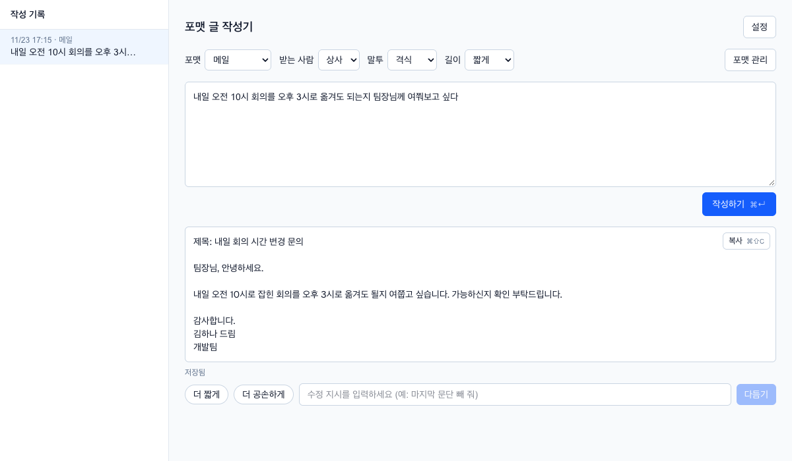

# 포맷 글 작성기

[](https://github.com/heejung0413/format-writer/actions/workflows/test.yml)

대충 적은 메모를 넣고 포맷(메일, 채팅, 보고 등)을 고르면 Claude가 그 포맷에 맞는 완성된 글로 다시 써 주는 개인용 웹사이트입니다. 내 컴퓨터(`localhost`)에서만 실행합니다.



## 기능

- **포맷에 맞춰 쓰기**: 내용을 적고 포맷을 고른 뒤 **작성하기**를 누르면 글이 타이핑되듯 나옵니다.
- **받는 사람과 말투**: 상사·동료·고객, 격식·보통·편하게 중에서 고릅니다.
- **다듬기**: 결과가 나온 뒤 **더 짧게**, **더 공손하게** 버튼이나 직접 쓴 수정 지시로 고칩니다.
- **나만의 포맷**: **포맷 관리**에서 포맷을 추가·수정·삭제합니다. 예시 글을 넣으면 그 구성을 따라 씁니다.
- **작성 기록**: 완성된 글은 자동으로 저장되고, 목록에서 누르면 입력·옵션·결과가 그대로 복원됩니다.
- **지어내지 않기**: 내용에 없는 날짜·이름·숫자는 `[날짜]`처럼 자리 표시로 남깁니다.

## 준비물

- Node.js 20.9 이상 (개발은 22에서 했습니다)
- [Claude Code](https://claude.com/claude-code)가 설치되어 있고 로그인된 상태 (터미널에서 `claude` 명령이 실행되어야 합니다)

## 실행

```bash
npm install
npm run dev
```

브라우저에서 http://localhost:4100 을 엽니다. 포트를 바꾸려면 `package.json`의 `-p 4100`을 고칩니다.

## Claude를 호출하는 방식

| 방식 | 설정 | 비용 |
|---|---|---|
| **Claude Code 계정** (기본) | 없음. 이 컴퓨터에 로그인된 계정을 그대로 씁니다 | 그 계정의 Claude Code 사용 한도 |
| **API 키** | `.env.local`에 `CLAUDE_PROVIDER=api`와 `ANTHROPIC_API_KEY` | 쓴 만큼 과금. [Console](https://console.anthropic.com)에서 크레딧 충전 필요 |

기본 방식에서는 서버가 `claude -p`를 실행해 글을 받아옵니다. 글만 쓰도록 도구, 훅, 플러그인, MCP 서버, `CLAUDE.md`는 모두 끄고 실행합니다.

API 키 방식으로 바꾸려면:

```bash
cp .env.example .env.local   # CLAUDE_PROVIDER=api, ANTHROPIC_API_KEY 입력
npm run dev                  # 서버를 다시 시작해야 반영됩니다
```

모델은 두 방식 모두 `claude-opus-5-5`가 기본이고, `.env.local`의 `CLAUDE_MODEL`로 바꿀 수 있습니다.

## 데이터

포맷과 작성 기록은 프로젝트 안의 JSON 파일에 저장됩니다.

- `data/formats.json`: 포맷 목록. 처음 실행하면 메일·채팅·보고 3개로 만들어집니다.
- `data/history.json`: 작성 기록. 최근 200건만 유지합니다.

`data/`와 `.env.local`은 git에 올라가지 않습니다. 파일이 깨져 있으면 `*.broken-<시각>`으로 옮겨 두고 기본값으로 다시 시작합니다.

## 구조

```
app/
  page.tsx                 화면 조립, 생성·다듬기·기록 흐름
  api/generate/            글 생성. 한 줄에 JSON 하나씩 흘려보냄(NDJSON)
  api/formats/             포맷 조회·추가·수정·삭제
  api/history/             기록 조회·추가·결과 갱신·삭제
components/                옵션 바, 입력, 결과, 기록 목록, 포맷 관리 모달
lib/
  prompt.ts                포맷·받는 사람·말투를 Claude에게 줄 지시문으로 조립
  provider.ts              호출 방식 선택 (Claude Code 계정 / API 키)
  claude-code.ts           claude -p 실행, 출력을 글 조각으로 변환
  claude.ts                Anthropic SDK 스트리밍 호출
  errors.ts                SDK 오류를 화면용 안내 문구로 변환
  store.ts                 JSON 파일 저장소 (한 번에 하나씩, 원자적 저장)
  ndjson.ts                브라우저에서 스트림 읽기
tests/                     Vitest 단위 테스트, tests/integration/ 통합 테스트
e2e/                       Playwright 브라우저 테스트, 가짜 claude(e2e/bin/claude)
docs/superpowers/          설계 문서와 구현 계획
```

글 생성 흐름: 브라우저 → `POST /api/generate` → 서버가 Claude 호출 → `{"type":"text"}` 줄이 차례로 도착 → `{"type":"done"}`을 받으면 기록에 저장합니다. 오류는 `{"type":"error"}` 줄로 오고 화면에 사유와 **다시 시도** 버튼이 나옵니다.

## 개발

```bash
npm run typecheck   # 타입 검사
npm run lint        # 린트
npm run build       # 프로덕션 빌드
```

테스트 실행 방법은 아래 "테스트"를 참고합니다.

기술: Next.js 16 (App Router), React 19, TypeScript, Tailwind CSS 4, `@anthropic-ai/sdk`, Vitest.

## 테스트

단위 테스트는 화면 컴포넌트, 서버 라우트, 저장소, Claude 호출 변환 같은 조각을 하나씩 따로 검증합니다. 통합 테스트(`tests/integration/`)는 화면을 실제로 그리고 실제 서버 라우트와 저장소(임시 폴더의 JSON 파일)까지 이어서 돌려, 작성하기부터 기록 저장까지 한 흐름으로 확인합니다. 통합 테스트에서 가짜로 바꾸는 것은 `claude` 프로세스뿐이고, 어느 테스트도 Claude를 실제로 호출하지 않습니다.

```bash
npm test                  # 단위 + 통합 테스트 전체
npm run test:integration  # 통합 테스트만
npm run test:coverage     # 커버리지 포함
```

E2E 테스트(`e2e/`)는 실제 Chrome 브라우저로 화면을 조작해 작성하기, 복사, 다듬기, 기록 복원·삭제, 포맷 관리, 중단, 오류 표시까지 사용자 흐름을 처음부터 끝까지 확인합니다. 실행할 때마다 다른 포트(4311)에 프로덕션 빌드를 `.next-e2e/`에 만들어 자체 서버를 띄우고, 데이터는 임시 폴더에 저장하며 `claude` 대신 `e2e/bin/claude`(가짜)를 쓰므로 `data/`와 개발 서버(4100)에 영향을 주지 않고 사용량도 들지 않습니다. 컴퓨터에 설치된 Google Chrome을 사용합니다.

```bash
npm run test:e2e          # E2E 테스트 (자체 서버를 띄우고 끝나면 종료)
npm run test:e2e:ui       # Playwright UI 모드로 실행
npm run test:e2e:real     # 진짜 claude를 호출하는 스모크 테스트 1건 (사용량이 듭니다)
```

마지막 명령만 진짜 Claude Code를 호출하므로 평소 실행에서는 빠져 있고, `E2E_REAL_CLAUDE=1`로 따로 실행할 때만 돌아갑니다.

`main`에 푸시하거나 풀 리퀘스트를 열면 GitHub Actions(`.github/workflows/test.yml`)가 타입 검사, 린트, 유닛·통합 테스트, E2E 테스트를 자동으로 돌립니다.

## 알아 둘 점

- 혼자, 내 컴퓨터에서 쓰는 도구입니다. 로그인이 없으므로 외부에 공개된 서버에 올리면 안 됩니다.
- 다른 웹페이지가 몰래 요청을 보내 사용량을 쓰지 못하도록, API는 `Content-Type: application/json` 요청만 받습니다.
- 생성 도중 **중단**하면 그때까지 나온 글은 화면에 남고 기록에는 저장되지 않습니다.
